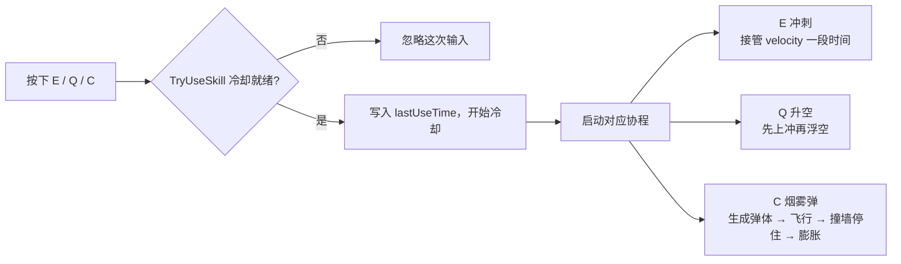

# 复刻 Valorant 日志 #1：能跑、能跳、能放技能的第一人称角色

## 一、实现效果

灰色场景，一个方块拼的人物，一把枪的模型。没有任何美术和 UI，但效果是一样的：

| 按键 | 行为 |
| --- | --- |
| `W` `A` `S` `D` | 水平移动，斜向不加速 |
| `Space` | 跳跃（只在贴地时生效） |
| 鼠标 | 水平转身 + 垂直俯仰，俯仰限制在 ±80° |
| `E` | 冲刺：沿当前输入方向位移，期间接管移动 |
| `Q` | 升空：先向上飞一下，再浮空一段时间 |
| `C` | 烟雾弹：从准星方向抛出，撞墙停住并膨胀成烟 |


## 二、角色是怎么拼起来的

```
Player                          ← Rigidbody + CapsuleCollider
├─ move.cs                      ← 水平移动 / 跳跃 / 地面判定
├─ frist_person_view.cs         ← 鼠标视角
├─ SkillController              ← 三个技能 + 冷却
└─ Camera (POV)                 ← 主相机，fpv.pov 指向它
```

三个脚本各管一件事，互相之间用 `public` 引用打通：`SkillController` 拿 `move` 的 `rb` 和 `canMove` 去接管移动，拿 `fpv.pov` 去算烟雾弹的出生点和朝向。

这种"直接互相引用"的方式在只有一个角色时够用，代价是耦合 —— 后面如果要做 AI 敌人复用这套脚本，就不好拆了。记在债上。

## 三、移动：直接改 velocity，而不是 AddForce

先把结论放前面：**FPS 角色别用 `AddForce` 做普通移动，用 `rb.velocity` 每物理帧直接覆盖水平速度。**

```csharp
void FixedUpdate()
{
    // 用 transform.right / forward，所以"往哪走"跟着视角走
    moveDir = transform.right * horizontal + transform.forward * vertical;
    moveDir.y = 0f;
    if (moveDir.sqrMagnitude > 1f) moveDir.Normalize();   // 斜向不加速

    if (!canMove) return;                                  // 冲刺期间由技能接管

    Vector3 v = moveDir * speed;
    v.y = rb.velocity.y;                                   // 竖着的那一份留给重力和跳跃
    rb.velocity = v;
}
```

三个细节：

1. **`sqrMagnitude > 1` 才归一化**。同时按下 `W` 和 `D` 时输入是 `(1,1)`，长度 1.41，不归一化斜着走会快 40%。用 `sqrMagnitude` 是为了少开一次根号（在这个量级纯属自娱自乐，但习惯是好的）。
2. **竖直速度必须保留**。整条速度被覆盖成 `moveDir * speed` 的话，`y` 会被抹成 0，人永远跳不起来、也永远在下坠和"重置"之间打架。
3. **覆盖而不是叠加，手感就是"急停"**。松手的那一帧速度立刻归零，没有惯性滑行 —— 这恰好是 Valorant 的手感基调。如果你想做的是《Apex》那类带惯性的移动，就得换成"往目标速度做插值/加速度"，这是两种完全不同的手感方向，一开始就要选。

跳跃走的是 `AddForce(..., ForceMode.Impulse)`，一次性给一个向上的冲量（当前 `jumpForce = 10`，跑速 `speed = 8`）：

```csharp
if (jumpRequested && IsGrounded)
{
    rb.velocity = new Vector3(rb.velocity.x, 0f, rb.velocity.z);  // 先清掉下落速度
    rb.AddForce(Vector3.up * jumpForce, ForceMode.Impulse);
}
```

先清 `y` 是为了"什么时候按空格都是同一个跳跃高度"，否则从高处下落的瞬间按跳，冲量会被下落速度吃掉一截。

### 坑 1：地面判定别用"每帧重置的布尔值"

第一版是这么写的：

```csharp
void FixedUpdate()
{
    // ... 移动代码
    isGrounded = false;          // 每帧先清掉
}

void OnCollisionStay(Collision col)
{
    foreach (ContactPoint c in col.contacts)
        if (c.normal.y > 0.5f) { isGrounded = true; return; }
}
```

看起来是"每帧重置、靠碰撞回调重新置位"，实际上 `OnCollisionStay` 是在物理步**之后**才回调的，所以 `FixedUpdate` 里读到的是上一轮的判定结果。站在稍微陡一点的斜坡上、或者贴着墙的时候，法线 `y` 会掉到 0.5 以下，于是每隔几帧就"假摔"一次 —— 表现就是**站在地上偶尔跳不起来**。

改成记录时间戳而不是布尔值：

```csharp
private float groundedUntil;

bool IsGrounded => Time.fixedTime < groundedUntil;

void OnCollisionStay(Collision col)
{
    foreach (ContactPoint c in col.contacts)
    {
        if (c.normal.y > 0.5f)
        {
            groundedUntil = Time.fixedTime + 0.1f;   // 一段时间内都算贴地
            return;
        }
    }
}
```

顺手白送一个 **土狼时间（coyote time）**：走出平台边缘后的 0.1 秒内仍然可以起跳，手感会宽容很多。这是那种"玩家永远注意不到，但去掉就会被骂"的细节。

## 四、视角：把"转身"和"抬头"分开

这里有一个必须做对的结构决策：**水平旋转属于身体，垂直俯仰只属于相机。**

如果让身体跟着俯仰一起转，那么低头的时候胶囊体就前倾了，撞击、贴墙、脚步声全乱套。所以 `frist_person_view` 里的分工是：

```csharp
void Update()
{
    // 用 GetAxisRaw：Mouse X/Y 本身就是"这一帧移动了多少"，不要再乘 Time.deltaTime
    float mx = Input.GetAxisRaw("Mouse X") * mouseSensitivity;
    float my = Input.GetAxisRaw("Mouse Y") * mouseSensitivity;

    player.Rotate(Vector3.up * mx);                    // 转身 → 交给身体
    pitch = Mathf.Clamp(pitch - my, -80f, 80f);        // 抬头 → 只存在相机上
}

void LateUpdate()
{
    // 相机永远在 Update 全部跑完之后才落位，避免和角色位移抢同一帧
    pov.position = player.TransformPoint(eyeOffset);
    pov.rotation = player.rotation * Quaternion.Euler(pitch, 0f, 0f);
}
```

两个点：

- **`LateUpdate` 不是可选项**。如果在 `Update` 里改相机位置，而角色的移动在 `FixedUpdate` 里，就会出现"相机先跟到旧位置、角色再瞬移"的错帧，表现是**低帧率下画面轻微抖动**。放到 `LateUpdate` 就稳定了。
- **相机是身体的孩子，但位置每帧由脚本算**。所以 `eyeOffset`（眼睛相对身体原点的高度，比如 `(0, 1.6, 0)`）必须自己给，而且 `Start` 里要先摆一次，否则第一帧相机会停在原点。

### 坑 2：鼠标灵敏度乘了 `Time.deltaTime`

最初的写法是：

```csharp
float mouseX = Input.GetAxis("Mouse X") * mouseSensitivity * Time.deltaTime;
```

`Input.GetAxis("Mouse X")` 返回的已经是"这一帧鼠标移动了多少"（一个增量），再乘 `Time.deltaTime` 等于**又乘了一遍时间**。后果不是"整体变慢"，而是**灵敏度随帧率变化**：60 fps 下乘 0.0167，144 fps 下乘 0.0069，同一款游戏在 144 Hz 显示器上转身速度只有一半多。

这种 bug 最阴险的地方是：你在自己的机器上测不出来，玩家一换配置就投诉"鼠标发飘"。判断标准很简单 —— **鼠标输入不乘 `deltaTime`，键盘长按的移动/旋转才乘**。

（同理，`Input.GetAxis` 自带平滑，`GetAxisRaw` 不带。视角要的是"所见即所得"，所以用 `Raw`。）

### 坑 3：把"每帧位移"当成"速度"

这个坑我藏得比较深，因为**它当时看起来是能跑的**。冲刺的实现是每帧给一次速度：

```csharp
while (timer < dashDuration)
{
    Vector3 targetVelocity = Dir * dashSpeed * Time.deltaTime;   // ← 问题在这
    targetVelocity.y = move.rb.velocity.y;
    move.rb.velocity = targetVelocity;
    timer += Time.deltaTime;
    yield return null;
}
```

`rb.velocity` 的单位是**米/秒**，而 `dashSpeed * Time.deltaTime` 算出来的是**每帧位移量（米）**。差了一个时间因子，实际速度只有设计值的 1/60。

当时我的反应不是去查量纲，而是"冲刺太慢了 → 把数字调大"，于是 `dashSpeed` 被我从十几一路调到 **650**，看起来就"对"了。这个补偿掩盖了真正的错误，而且它补偿不了帧率：

```
冲刺距离 = dashSpeed × Time.deltaTime × dashDuration
```

60 fps 时 `650 × 0.0167 × 0.6 ≈ 6.5 米`，144 fps 时 `650 × 0.0069 × 0.6 ≈ 2.7 米`。**同一份代码，换台电脑冲刺距离差一倍多。**

改法是让代码里的单位回到物理意义，数字也跟着回到人类可读的范围：

```csharp
Vector3 v = Dir * dashSpeed;      // dashSpeed 就是米/秒，给 10~13 就够了
v.y = move.rb.velocity.y;         // 竖直速度不动，所以可以在空中冲刺
move.rb.velocity = v;
```

教训：**`deltaTime` 只应该出现在"每帧要累加的量"上**（计时器、每帧位移、每帧加速度）。一旦它出现在一个"速度"或"位置"的表达式里，几乎一定是量纲错了。也顺手记个自查信号：**如果你在 Inspector 里把一个速度字段调到 650，那不是手感问题，是公式问题。**

## 五、技能：数据和行为分开

### 5.1 冷却是一个纯数据的事

三个技能的冷却逻辑完全一样，所以先把"冷却"抽出来，不要复制三份：

```csharp
[System.Serializable]
public class Skill
{
    public string skillName;
    public float cooldown = 5f;

    [System.NonSerialized] public float lastUseTime = -Mathf.Infinity;

    public bool  IsReady           => Time.time >= lastUseTime + cooldown;
    public float RemainingCooldown => Mathf.Max(0f, lastUseTime + cooldown - Time.time);

    // 0 → 1 的进度，UI 的环形遮罩直接读这个值
    public float CooldownProgress  => cooldown <= 0f ? 1f
                                    : Mathf.Clamp01((Time.time - lastUseTime) / cooldown);
}
```

只存一个 `lastUseTime`，剩下的全部由属性算出来 —— **不存"剩余冷却"这种会飘的状态**，就不会出现"计时器和 UI 对不上"的经典 bug。`CooldownProgress` 是给 UI 准备的：后面做环形冷却遮罩时，`Image.fillAmount` 直接喂这个值。

### 5.2 整个释放流程



入口很朴素，就是一个按键映射表：

```csharp
void Update()
{
    if (Input.GetKeyDown(KeyCode.E) && TryUseSkill(0)) StartCoroutine(CastSkill1());
    if (Input.GetKeyDown(KeyCode.Q) && TryUseSkill(1)) StartCoroutine(CastSkill2());
    if (Input.GetKeyDown(KeyCode.C) && TryUseSkill(2)) StartCoroutine(CastSkill3());
}

public bool TryUseSkill(int index)
{
    var s = skills[index];
    if (s == null || !s.IsReady) return false;
    s.lastUseTime = Time.time;      // 只有真的放出去了才消耗冷却
    return true;
}
```

`TryUseSkill` 返回 `bool`、并且**先判断再扣冷却**，这个顺序很重要：如果把扣冷却写在协程里，中途被打断就会白白吃掉一次 CD。

### 5.3 三个技能各自的实现要点

**E 冲刺** —— 本质是"临时把普通移动关掉，自己接管速度"：

```csharp
IEnumerator CastSkill1()
{
    float timer = 0f;
    Vector3 dir = move.moveDir.sqrMagnitude < 0.01f
        ? move.transform.forward          // 站着不动时朝脸的方向冲
        : move.moveDir.normalized;

    move.canMove = false;                 // ← 关键：让 move.cs 别来抢 velocity
    try
    {
        while (timer < dashDuration)
        {
            Vector3 v = dir * dashSpeed;
            v.y = move.rb.velocity.y;
            move.rb.velocity = v;
            timer += Time.deltaTime;
            yield return null;            // 每帧放一次手，下一帧接着冲
        }
    }
    finally
    {
        move.canMove = true;              // 被 StopCoroutine 打断也能恢复
    }
}
```

`try/finally` 在协程里是有效的：即使外部 `StopCoroutine`，`finally` 也会执行。这样"冲刺完没恢复移动"这类恶性 bug 从结构上就不会发生。

**Q 升空** —— 先给一个向上的初速度，再靠持续的升力浮空：

```csharp
IEnumerator CastSkill2()
{
    float timer = 0f;
    while (timer < floatDuration)
    {
        if (timer < flyDuration)
        {
            // 用固定值覆盖，而不是每帧累加 —— 累加的写法会让上冲高度随帧率变化
            move.rb.velocity = new Vector3(move.rb.velocity.x, flySpeed, move.rb.velocity.z);
        }
        move.rb.AddForce(move.transform.up * lift);   // 抵消重力，慢慢浮
        timer += Time.deltaTime;
        yield return null;
    }
}
```

这里"上冲"和"浮空"用了机制不同的两套东西（直接改速度 / 加力），是为了让曲线好看：**开头是爆发，后面是悬停**。但如果两个参数配不好，会出现"先窜一下、然后往下掉、再被托住"的抽搐感 —— 更可控的做法是用一条 `AnimationCurve` 描述"目标高度随时间的曲线"，然后每帧用 `MoveTowards` 去追。

**C 烟雾弹** —— 出生 → 匀速飞行 → 撞墙 → 定住 → 膨胀 → 销毁。预制体是一个父物体（`Rigidbody`，关掉重力）+ 子物体 `Sphere`（`SphereCollider`）：

```csharp
GameObject smoke = Instantiate(smokePrefab, pov.position, pov.rotation);
Rigidbody srb = smoke.GetComponent<Rigidbody>();
Vector3 dir = pov.rotation * Vector3.forward;   // 朝准星方向
srb.velocity = dir * smokeFlySpeed;

while (smoke != null)
{
    // 自己扫一遍，命中就停 —— 不指望物理引擎替我停下
    if (srb.SweepTest(dir, out _, 1.2f, QueryTriggerInteraction.Ignore))
    {
        srb.velocity = Vector3.zero;
        srb.angularVelocity = Vector3.zero;
        srb.isKinematic = true;                       // 停住，不再被物理推动
        foreach (var col in smoke.GetComponentsInChildren<Collider>())
            col.enabled = false;                      // 关碰撞，否则人会被烟的体积顶开
    }
    yield return null;
}
```

**为什么不用物理碰撞让它自己撞停？** 因为我要的是"撞到就定住"，不是"撞到弹开"：物理引擎会给你反弹、滚一段，速度太快还会穿墙；而"停下来之后立刻开始膨胀成烟"这个时机，物理引擎也管不了。FPS 里的抛投物基本都这么做 —— **当你要的是"撞到就停"而不是"撞到弹开"时，就别让物理引擎替你决定。**

### ✅ 几个一开始就做对了的地方

只写坑不够，这几个决定我认为值得保留：

1. **协程里每帧 `yield return null`**。`IEnumerator` 是"遇到 `yield` 才让出控制权"的，一个没有 `yield` 的 `while` 会在**一帧内**跑完 —— `StartCoroutine` 看起来像启动了一个持续行为，实际什么也没持续。所以凡是"持续一段时间"的循环，第一件事是确认循环体里有 `yield`。
2. **冷却只存 `lastUseTime`**，不存"剩余时间"。
3. **`TryUseSkill` 先判断再扣冷却**，失败了不吃 CD。
4. **`SweepTest` 而不是等物理碰撞**。

## 六、当前的代码债

诚实地列一下，免得骗自己"差不多了"：

| 问题 | 现在能忍的原因 | 什么时候必须还 |
| --- | --- | --- |
| 类名 `move` / `frist_person_view`，字段 `smock`（`smoke` 拼错） | 只有三个脚本，改起来没成本 | 脚本超过 10 个就还 |
| `Awake()` 里硬编码三个 `skillName`，把 Inspector 里已经起好的名字又覆盖成 `dash / smoke / suspend`，而且顺序和实际键位错位（`Q` 是升空却叫 `smoke`） | 现在还没做 UI，名字没人读 | **做冷却 UI 之前**，否则图标和技能对不上 |
| 技能参数全暴露在 Inspector，命名和实现不一致（`MaxFlyTime`、`smockMag` 等字段其实没被用到） | 调数值时很爽 | 要做多角色 / 皮肤化技能时 |
| 技能时长硬编码在协程里 | 三个技能各写一遍还行 | 出现第 4 个技能时 |
| 每帧 `Debug.Log("正在冲刺")` / `("正在浮空")` 刷屏 | 调试期方便 | 接上 UI 之后，日志会淹没真正有用的信息 |
| 输入写死在 `Update` 里 | 现在只考虑键鼠 | 要做按键改绑 / 手柄时 |
| 协程之间没有优先级和打断规则，两个技能能同时改 `velocity` 互相覆盖 | 单技能时看不出来 | **下一个技能之前** |
| 源文件是 GBK 编码 | 本地 IDE 显示正常 | 传 GitHub 之前 —— 网页上中文注释会乱码，存成 UTF-8 |

## 七、下一步

按优先级排：

1. **修坑**：地面判定的时间戳方案、鼠标灵敏度、冲刺的量纲（顺便把 `dashSpeed` 从 650 改回十几）、清掉 `Awake()` 里的硬编码名字 —— 半天能清完。
2. **技能冷却 UI**：用 `CooldownProgress` 驱动 `Image.fillAmount`，三个技能图标 + 数字倒计时。
3. **射击和命中判定**：`Raycast` + 弹孔 + 简单伤害。有了伤害，"技能"才有意义。
4. **一个会动不会还手的假人 Bot**：没有靶子，所有手感都没法验证。
5. **抽 `ScriptableObject`**：把技能数值从代码里搬到资源里，这是从"能跑"走向"能调"的分水岭。

## 八、参考

- [Unity Manual — Rigidbody Physics](https://docs.unity3d.com/Manual/RigidbodyPhysics.html)
- [Unity Manual — Order of execution for event functions](https://docs.unity3d.com/Manual/ExecutionOrder.html)
- [Unity Scripting API — Physics.SphereCast](https://docs.unity3d.com/ScriptReference/Physics.SphereCast.html)
- [Unity Scripting API — Rigidbody.SweepTest](https://docs.unity3d.com/ScriptReference/Rigidbody.SweepTest.html)
- [Unity Manual — Coroutines](https://docs.unity3d.com/Manual/Coroutines.html)

---

*本文对应代码提交：`feat: 第一人称角色移动 / 视角 / 三技能`（Unity 2022.3.62f1c1）*
*系列目录：[Valorant 复刻日志](../../README.md)*
